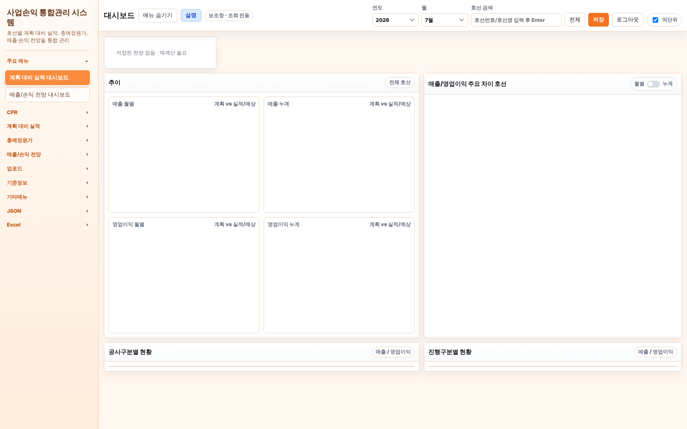
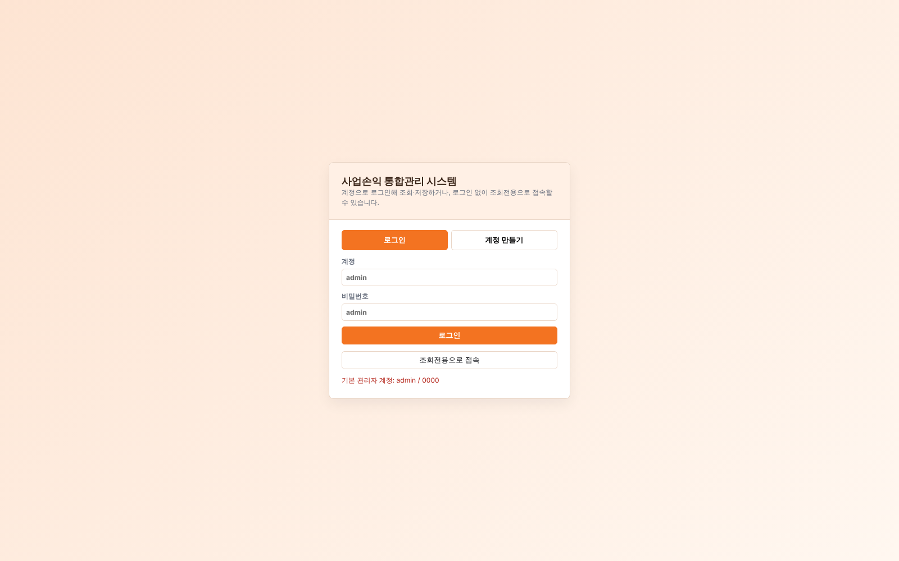
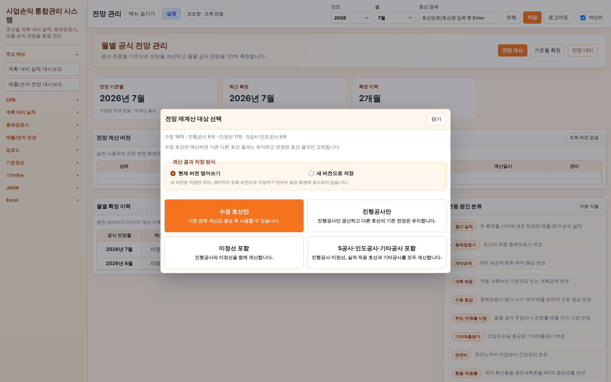
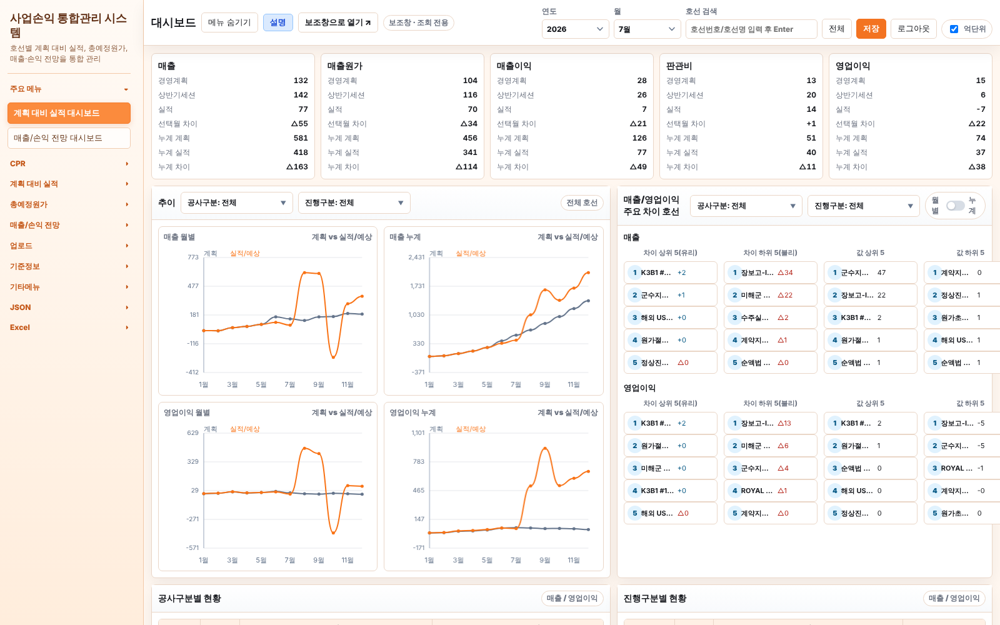

# 사업손익 통합관리 시스템 — 계획 대비 실적 대시보드 화면 사용 설명서

- 대상 파일: `plan-actual-dashboard.html` (목업 화면)
- 함께 사용하는 데이터 파일: `재무-20261008.json` (호선 JSON 파일)
- 작성일: 2026년 10월 12일
- 확인 방법: 목업 파일을 브라우저에서 직접 열고, 첨부된 JSON 파일을 실제로 불러온 뒤 모든 메뉴를 하나씩 눌러 확인함

---

## 목차

1. 이 화면이 비어 보이는 이유 (가장 먼저 읽을 것)
2. 처음부터 끝까지 따라 하는 순서
3. 화면 구성 전체 그림
4. 화면 위쪽 막대(상단 도구 막대) 설명
5. 요약 카드 5개 설명
6. 추이 그래프 4개 설명
7. 매출/영업이익 주요 차이 호선 설명
8. 공사구분별 현황 / 진행구분별 현황 표 설명
9. 왼쪽 메뉴 전체 설명
10. JSON 메뉴 4개 버튼의 차이
11. 자주 생기는 문제와 해결 방법
12. 꼭 알아야 할 주의 사항

---

## 1. 이 화면이 비어 보이는 이유 (가장 먼저 읽을 것)

### 1-1. 비어 있는 화면의 모습



- 왼쪽 위 카드에 **"저장된 전망 없음 · 재계산 필요"** 라고만 나옵니다.
- 그래프 4개는 틀만 있고 선이 없습니다.
- 오른쪽 "주요 차이 호선"과 아래쪽 표도 비어 있습니다.

### 1-2. 원인

이 프로그램은 데이터를 화면에 보여주기까지 **두 단계**를 거칩니다.

| 단계 | 하는 일 | 이 단계만 하면 보이는 화면 |
|---|---|---|
| 1단계: 호선 JSON 불러오기 | 계획, 실적, 총예정원가, 호선정보 같은 **원천 데이터**를 프로그램에 넣습니다. | 계획 대비 실적, 총예정원가, 호선정보, 현금흐름 화면 |
| 2단계: 전망 계산 | 넣은 원천 데이터로 **전망 결과를 계산해서 저장**합니다. | **대시보드**, 매출/손익 전망 화면 전체, CPR Section1, 년도별 손익 |

**계획 대비 실적 대시보드는 2단계 결과(전망 계산 결과)가 없으면 아무것도 그리지 않고 멈추도록 만들어져 있습니다.**

또한 호선 JSON을 불러오면 프로그램이 **기존 전망 계산 결과를 일부러 지웁니다.** 원천 데이터가 바뀌었으니 다시 계산하라는 뜻입니다. 따라서 **JSON을 불러올 때마다 반드시 전망 계산을 다시 해야 합니다.**

### 1-3. 프로그램 안에서 실제로 멈추는 위치 (참고용)

화면을 그리는 `render()` 함수 안에서, 전망 계산 결과가 없으면 안내 문구만 넣고 바로 끝납니다.

```js
const forecastCacheReady = !needsForecastDisplayCache
  || restoreForecastCalculatedCacheForDisplay(state.selectedYear, forecastDisplayOptions);
if (needsForecastDisplayCache && !forecastCacheReady && state.selectedView !== "integratedDashboard") {
  ...
  $("summaryCards").innerHTML = `... 저장된 전망 없음 · 재계산 필요 ...`;
  return;   // 여기서 끝나므로 요약 카드, 그래프, 순위, 표를 그리는 코드가 실행되지 않음
}
```

호선 JSON을 불러올 때 실행되는 `applyHullPackageToState()` 함수 안에서 전망 결과를 지웁니다.

```js
state.forecastCalculatedCache = null;              // 전망 계산 결과 삭제
state.forecastSourceReason = "호선 JSON 불러오기";
```

---

## 2. 처음부터 끝까지 따라 하는 순서

### 2-1. 관리자로 로그인



1. 목업 HTML 파일을 브라우저로 엽니다.
2. **계정** 칸에 `admin`, **비밀번호** 칸에 `0000`을 입력합니다.
3. 주황색 **[로그인]** 버튼을 누릅니다.

> **주의:** **[조회전용으로 접속]**을 누르면 왼쪽 메뉴의 **JSON** 묶음과 **Excel** 묶음이 보이지 않습니다. JSON 파일을 불러오려면 반드시 관리자 계정으로 로그인해야 합니다.

### 2-2. 호선 JSON 불러오기

1. 왼쪽 메뉴 맨 아래쪽 **JSON** 글자를 눌러 묶음을 펼칩니다.
2. **[호선 JSON 불러오기]** 를 누릅니다. (**[전체 JSON 불러오기]가 아닙니다.**)
3. 파일 선택 창에서 `재무-20261008.json` 을 고릅니다.
4. 호선 목록 창이 뜹니다. 호선 19개가 모두 체크되어 있는지 확인하고 **[불러오기]** 를 누릅니다.
5. "선택한 호선 19개를 불러올까요?" 확인 창에서 **[확인]** 을 누릅니다.
6. 화면 위쪽 저장 상태 표시줄에 아래 문구가 나오면 성공입니다.

   > `재무-20261008.json: 19개 호선 불러오기 완료 · 전망 재계산 필요`

### 2-3. 결산 최종월 확인

1. 왼쪽 메뉴 **기준정보 → 기준정보** 를 누릅니다.
2. **결산 최종월** 칸을 확인합니다.

| 항목 | 내용 |
|---|---|
| 결산 최종월의 뜻 | "실적은 이 달까지 사용하고, 그 다음 달부터는 전망으로 계산한다"는 기준선입니다. |
| JSON에 들어 있는가 | **들어 있지 않습니다.** 프로그램 처음 실행 시 기본값은 `2026-07` 입니다. |
| 보내주신 JSON의 실적 기간 | 2026년 8월까지 있습니다. |
| 권장 값 | 8월 실적까지 반영하려면 `2026-08` 로 입력합니다. |

### 2-4. 전망 계산 실행

1. 왼쪽 메뉴 **매출/손익 전망 → 전망 관리** 를 누릅니다.
2. 화면 오른쪽 위 주황색 **[전망 계산]** 버튼을 누릅니다.
3. "전망 재계산 대상 선택" 창이 뜹니다.



### 2-5. 계산 대상 선택 (가장 많이 실수하는 곳)

| 버튼 | 계산하는 호선 | 이번에 사용해도 되는가 |
|---|---|---|
| **수정 호선만** (주황색) | 바뀐 호선만 | **사용 불가.** 전체 계산을 한 번 하기 전에는 **눌러도 아무 반응이 없습니다.** 주황색이라 기본 버튼처럼 보이지만 비활성 상태입니다. |
| 진행공사만 | 진행공사 3척 | **사용 불가.** 나머지 16척이 계산에서 빠집니다. |
| 미정선 포함 | 진행공사 + 미정선 | 인도공사 5척이 빠집니다. |
| **S공사·인도공사·기타공사 포함** | 전체 호선 | **이 버튼을 누릅니다.** |

- 보내주신 JSON의 호선 구성: 미정선 11척, 인도공사 5척, 진행공사 3척 (합계 19척)
- 창 위쪽 **"계산 결과 저장 방식"** 은 **"현재 버전 덮어쓰기"** 를 그대로 둡니다.
  - **"새 버전으로 저장"** 을 고르면 결과가 저장만 되고 화면에는 표시되지 않습니다. 이 경우 전망 관리 화면의 **"전망 계산 버전"** 표에서 해당 버전을 **조회 버전으로 지정**해야 화면에 나옵니다.
- 계산은 데이터 양에 따라 1분에서 3분 정도 걸립니다.
- 끝나면 저장 상태 표시줄에 아래 문구가 나옵니다.

  > `S공사·인도공사·기타공사 포함 전망 계산 및 저장이 완료되었습니다. 현재 조회 버전에 덮어썼습니다.`

### 2-6. 대시보드 확인

1. 왼쪽 메뉴 **주요 메뉴 → 계획 대비 실적 대시보드** 를 누릅니다.
2. 화면 오른쪽 위에서 **연도**(예: 2026)와 **월**(예: 8월)을 고릅니다.
3. 아래 그림처럼 요약 카드, 추이 그래프, 주요 차이 호선, 하단 표가 모두 나타납니다.
4. 브라우저를 새로고침해도 그대로 유지되는 것을 확인했습니다.



---

## 3. 화면 구성 전체 그림

```
┌──────────────┬──────────────────────────────────────────────────────────────┐
│              │ ④ 상단 도구 막대 (화면 제목, 연도, 월, 호선 검색, 저장, 억단위 등) │
│              ├──────────────────────────────────────────────────────────────┤
│  ⑨ 왼쪽 메뉴  │ ⑤ 요약 카드 5개 : 매출 │ 매출원가 │ 매출이익 │ 판관비 │ 영업이익  │
│              ├───────────────────────────────┬──────────────────────────────┤
│              │ ⑥ 추이                         │ ⑦ 매출/영업이익 주요 차이 호선 │
│              │  매출 월별    │ 매출 누계        │  매출 : 차이상위5 / 차이하위5 │
│              │  영업이익 월별 │ 영업이익 누계    │        값상위5  / 값하위5    │
│              │                               │  영업이익 : 위와 같음          │
│              ├───────────────────────────────┼──────────────────────────────┤
│              │ ⑧ 공사구분별 현황 표            │ ⑧ 진행구분별 현황 표           │
└──────────────┴───────────────────────────────┴──────────────────────────────┘
```

---

## 4. 화면 위쪽 막대(상단 도구 막대) 설명

| 위치 | 이름 | 기능 |
|---|---|---|
| 왼쪽 | **대시보드** (화면 제목) | 현재 보고 있는 화면 이름입니다. |
| 왼쪽 | **[메뉴 숨기기]** | 왼쪽 메뉴를 접어 화면을 넓게 씁니다. 다시 누르면 펼쳐집니다. |
| 왼쪽 | **[설명]** | 이 화면의 간단한 도움말 창을 엽니다. |
| 왼쪽 | **[보조창으로 열기 ↗]** | 같은 화면을 **새 창(조회 전용)** 으로 엽니다. 두 화면을 나란히 비교할 때 씁니다. 보조창에서는 저장과 JSON 불러오기를 할 수 없습니다. |
| 왼쪽 | **보조창 · 조회 전용** (표시) | 보조창 기능이 있다는 표시입니다. |
| 가운데 | 저장 상태 표시줄 | "불러오기 완료", "전망 재계산 필요", "저장 완료" 같은 진행 상태가 나옵니다. **문제가 생기면 이 문구를 먼저 확인합니다.** |
| 오른쪽 | **연도** | 조회할 연도를 고릅니다. |
| 오른쪽 | **월** | 조회할 월을 고릅니다. 요약 카드의 "선택월"과 "누계(1월부터 선택월까지)"의 기준이 됩니다. |
| 오른쪽 | **호선 검색** | 호선번호 또는 호선명을 입력하고 **Enter** 를 누르면 그 호선만 집계합니다. 계획 단계 번호(계획호선번호)로 검색해도 같은 호선을 찾습니다. |
| 오른쪽 | **[전체]** | 호선 검색을 지우고 전체 호선으로 되돌립니다. |
| 오른쪽 | **[저장]** | 현재 변경 내용을 저장합니다. 로그인한 사용자만 저장할 수 있습니다. |
| 오른쪽 | **[로그아웃]** / **[로그인]** | 로그인 상태에 따라 바뀝니다. |
| 오른쪽 | **억단위** (체크 상자) | 켜면 금액을 **억 원 단위**로, 끄면 **원 단위**로 표시합니다. |

---

## 5. 요약 카드 5개 설명

카드는 **매출, 매출원가, 매출이익, 판관비(판매비와관리비), 영업이익** 순서로 5개가 있습니다. 각 카드의 줄 구성은 같습니다.

| 줄 | 뜻 | 기간 |
|---|---|---|
| 경영계획 | 연초 경영계획 금액 | 선택한 월 1개월 |
| 상반기세션 | 상반기 수정 계획 금액 | 선택한 월 1개월 |
| 실적 | 실제 결산 금액 | 선택한 월 1개월 |
| 선택월 차이 | **실적 − 경영계획** | 선택한 월 1개월 |
| 누계 계획 | 경영계획 합계 | 1월부터 선택한 월까지 |
| 누계 실적 | 실적 합계 | 1월부터 선택한 월까지 |
| 누계 차이 | **누계 실적 − 누계 계획** | 1월부터 선택한 월까지 |

### 차이 숫자 읽는 법

| 표시 | 뜻 | 예시 |
|---|---|---|
| `+3` | 실적이 계획보다 **3억 많음** | 매출 계획 10억, 실적 13억 → `+3` |
| `△3` | 실적이 계획보다 **3억 적음** (△는 마이너스 표시) | 매출 계획 10억, 실적 7억 → `△3` |
| `-` | 차이 없음 | |

> **주의:** 차이는 모든 카드에서 똑같이 "실적 − 계획"으로 계산합니다. 매출과 이익은 `+`가 좋은 결과지만, **매출원가와 판관비는 `+`가 계획보다 비용을 더 썼다는 뜻**입니다.

### 계산 예시 (전망 계산 후 실제 화면 값, 억단위 켬, 2026년 7월 기준)

| 카드 | 경영계획 | 실적 | 선택월 차이 | 누계 계획 | 누계 실적 | 누계 차이 |
|---|---|---|---|---|---|---|
| 매출 | 132 | 77 | △55 | 581 | 418 | △163 |
| 영업이익 | 15 | -7 | △22 | 74 | 37 | △38 |

> 위 숫자에는 프로그램이 처음 실행 때 자동으로 만든 **샘플 호선 8척**이 함께 들어 있습니다. (12장 참고)

---

## 6. 추이 그래프 4개 설명

| 그래프 | 가로축 | 세로축 | 회색 선 | 주황색 선 |
|---|---|---|---|---|
| 매출 월별 | 1월~12월 | 억 원 | 계획 | 실적/예상 |
| 매출 누계 | 1월~12월 | 억 원 | 1월부터 쌓은 계획 | 1월부터 쌓은 실적/예상 |
| 영업이익 월별 | 1월~12월 | 억 원 | 계획 | 실적/예상 |
| 영업이익 누계 | 1월~12월 | 억 원 | 1월부터 쌓은 계획 | 1월부터 쌓은 실적/예상 |

### 주황색 선(실적/예상)이 만들어지는 방식

| 구간 | 매출 | 영업이익 |
|---|---|---|
| 결산 최종월까지 | 실적 | 전망 계산 결과 |
| 결산 최종월 다음 달부터 | **전망 계산 결과(예상)** | 전망 계산 결과 |

예시: 결산 최종월이 2026-07이면 1월~7월은 실적, 8월~12월은 예상 값입니다. 이 때문에 **전망 계산을 하지 않으면 그래프가 그려지지 않습니다.**

### 그래프 위쪽 거르기(필터)

| 항목 | 기능 |
|---|---|
| **공사구분: 전체** | 공사구분(보내주신 JSON 기준: 수상함 7척, MRO 7척, K공사 3척, 수중함 1척, 미지정 1척)을 골라 그 호선만 집계합니다. |
| **진행구분: 전체** | 진행구분(진행공사, 미정선, 인도공사 등)을 골라 그 호선만 집계합니다. |
| **전체 호선** (오른쪽 표시) | 상단 호선 검색으로 고른 호선 이름이 표시됩니다. |

> 전망 대상에서 제외된 호선(호선정보의 "전망여부"가 X인 호선)은 추이 그래프에서 빠집니다.

---

## 7. 매출/영업이익 주요 차이 호선 설명

매출과 영업이익 각각에 대해 4개의 순위 목록을 보여줍니다.

| 목록 | 정렬 기준 | 의미 |
|---|---|---|
| 차이 상위 5(유리) | (실적 − 계획)이 큰 순서 | 계획보다 가장 잘 나온 호선 |
| 차이 하위 5(불리) | (실적 − 계획)이 작은 순서 | 계획보다 가장 못 나온 호선 |
| 값 상위 5 | 실적이 큰 순서 | 실적 금액이 가장 큰 호선 |
| 값 하위 5 | 실적이 작은 순서 | 실적 금액이 가장 작은 호선 (손실 호선 확인용) |

| 조작 | 기능 |
|---|---|
| **월별 / 누계** 전환 스위치 | 끄면 선택월 1개월, 켜면 1월부터 선택월까지 누계로 순위를 다시 매깁니다. |
| **공사구분 / 진행구분** 거르기 | 추이 그래프와 별도로 이 순위 목록에만 적용됩니다. |
| **호선 이름 누르기** | 그 호선이 선택된 상태로 **계획 대비 실적 → 당월분석** 화면으로 이동합니다. |

- 차이가 0인 호선은 차이 순위에서 빠지고, 실적이 0인 호선은 값 순위에서 빠집니다.
- 해당되는 호선이 없으면 "데이터가 없습니다."가 표시됩니다.

---

## 8. 공사구분별 현황 / 진행구분별 현황 표 설명

두 표의 열 구성은 같고, **행을 나누는 기준만 다릅니다.**

| 표 | 행 기준 | 행 예시 |
|---|---|---|
| 공사구분별 현황 | 호선정보의 공사구분 | 수상함, MRO, K공사, 수중함, 미지정 … , 합계 |
| 진행구분별 현황 | 호선정보의 진행구분 | 진행공사, 미정선, 인도공사 … , 합계 |

| 열 | 내용 |
|---|---|
| 구분 | 행 이름 |
| 호선수 | 해당 구분의 호선 수 |
| 월 → 매출 (계획 / 실적 / 차이) | 선택한 월 1개월 |
| 월 → 영업이익 (계획 / 실적 / 차이) | 선택한 월 1개월 |
| 누계 → 매출 (계획 / 실적 / 차이) | 1월부터 선택한 월까지 |
| 누계 → 영업이익 (계획 / 실적 / 차이) | 1월부터 선택한 월까지 |

- 맨 아래 **합계** 행은 강조 색으로 표시됩니다.
- 표 오른쪽 위 **"매출 / 영업이익"** 은 표에 들어 있는 항목을 알려주는 표시입니다.

---

## 9. 왼쪽 메뉴 전체 설명

"JSON 직후"는 호선 JSON을 불러온 직후, "계산 후"는 전망 계산까지 마친 뒤의 상태입니다. (○ 표시됨, ✕ "저장된 전망 없음 · 재계산 필요")

### 9-1. 주요 메뉴

| 메뉴 | 기능 | JSON 직후 | 계산 후 |
|---|---|---|---|
| 계획 대비 실적 대시보드 | 이 설명서의 화면 | ✕ | ○ |
| 매출/손익 전망 대시보드 | 연간 매출·손익 전망 요약 | ✕ | ○ |

### 9-2. CPR (원가 성과 보고)

| 메뉴 | 기능 | JSON 직후 | 계산 후 |
|---|---|---|---|
| Section1 | 전망 요약 보고 | ✕ | ○ |
| Section2 | 호선별 상세 보고 (호선을 골라야 표시) | 호선 선택 필요 | 호선 선택 필요 |
| R&O | 위험(Risk)과 기회(Opportunity) 항목 관리 | ○ | ○ |
| 이슈 및 리스크 관리 | 호선별 이슈와 리스크 목록 | ○ | ○ |

### 9-3. 계획 대비 실적

| 메뉴 | 기능 | JSON 직후 | 계산 후 |
|---|---|---|---|
| 당월분석 | 항목별 계획 대비 실적 차이 분석 | ○ | ○ |
| 재료비 상세 | 재료비 코드별 계획·실적 비교 | ○ | ○ |
| 직접경비 상세 | 직접경비 코드별 계획·실적 비교 | ○ | ○ |
| 연간 비교표 | 1월~12월 계획·실적 비교표 | ○ | ○ |
| 계획간 비교 | 경영계획과 상반기세션 비교 | ○ | ○ |

### 9-4. 총예정원가

| 메뉴 | 기능 | JSON 직후 | 계산 후 |
|---|---|---|---|
| 당월분석 | 전월 대비 총예정원가 변동 분석 | ○ | ○ |
| 재료비 상세 | 재료비 코드별 총예정원가 | ○ | ○ |
| 직접경비 상세 | 직접경비 코드별 총예정원가 | ○ | ○ |
| 연간 비교표 | 월별 총예정원가 비교표 | ○ | ○ |

### 9-5. 매출/손익 전망

| 메뉴 | 기능 | JSON 직후 | 계산 후 |
|---|---|---|---|
| **전망 관리** | **[전망 계산]** 버튼이 있는 곳. 계산 버전과 월별 확정 이력 관리 | 계산 버튼만 사용 가능 | ○ |
| Profit&Loss | 손익계산서 형태의 전망 | ✕ | ○ |
| 계약 및 CO | 계약금액과 계약 변경(Change Order) | ✕ | ○ |
| 매출 | 호선별 월별 매출 전망 | ✕ | ○ |
| 손익 | 호선별 월별 손익 전망 | ✕ | ○ |
| 총예정원가 | 전망용 총예정원가 | ✕ | ○ |
| 시수 | 작업 시간 전망 | ✕ | ○ |
| 투입원가 | 월별 원가 투입 전망 | ✕ | ○ |
| 진행률 | 공정 진행률 전망 | ✕ | ○ |
| 기타매출원가 | 충당금 등 기타 원가 전망 | ✕ | ○ |
| 판관비 | 판매비와관리비 전망 | ✕ | ○ |

### 9-6. 업로드

| 메뉴 | 기능 | 비고 |
|---|---|---|
| 통합 업로드 | 계획, 실적, 시수 등의 CSV 엑셀 파일을 올리는 화면 | JSON과 관계없음 |

### 9-7. 기준정보

| 메뉴 | 기능 | JSON 직후 | 계산 후 |
|---|---|---|---|
| 기준정보 | **환율, 결산 최종월** 설정 | JSON에 없음, **직접 확인 필요** | 같음 |
| 호선정보 | 호선번호, 호선명, 공사구분, 진행구분, 일정, 계약금액 | ○ (19척 추가) | ○ |
| 년도별 수주 | 연도별 수주 계획 | ○ | ○ |
| 년도별 손익 | 연도별 손익 전망 | ✕ | ○ |

### 9-8. 기타메뉴

| 메뉴 | 기능 |
|---|---|
| 현금흐름(CF) 대시보드, 수금 계획, 통합계획, CF정보 | 현금흐름 관리 (JSON 직후부터 표시) |
| 월 결산 보고서 | 월 결산 보고서 출력 |
| 검증센터 | 데이터 정합성 점검 |
| 개발 이력 | 프로그램 변경 이력 |
| 사용자 관리 | 계정과 권한 관리 |

### 9-9. JSON / Excel (관리자로 로그인했을 때만 보임)

10장 참고.

---

## 10. JSON 메뉴 4개 버튼의 차이

| 버튼 | 하는 일 | 파일 이름 예시 | 기존 데이터에 미치는 영향 |
|---|---|---|---|
| 전체 JSON 저장 | 시스템 **전체** 데이터를 파일로 백업 | `plan-actual-dashboard-2026-10-08.json` | 없음 |
| 전체 JSON 불러오기 | 전체 백업 파일로 복원 | 위와 같은 전체 백업 파일 | **현재 데이터 전체가 교체됨** |
| 호선 JSON 내보내기 | **고른 호선만** 파일로 내보냄 | `재무-20261008.json` | 없음 |
| **호선 JSON 불러오기** | 파일 안의 호선만 넣음 | `재무-20261008.json` ← **보내주신 파일** | 파일 안의 호선만 교체, **다른 호선은 그대로 유지** |

> 보내주신 파일을 **[전체 JSON 불러오기]** 로 열면 아래 오류가 나고 아무것도 들어가지 않습니다.
>
> `복원 JSON에 정상적인 계획·실적 데이터가 없습니다.`

### 호선 JSON 파일에 들어 있는 것과 없는 것

| 들어 있음 | 들어 있지 않음 (직접 설정 필요) |
|---|---|
| 호선정보 19척 | 결산 최종월 |
| 계획 (경영계획 5,252건, 상반기세션 3,251건) | 환율 |
| 실적 3,568건 (2026년 8월까지) | 사용자 계정 |
| 총예정원가, 최초예산, 계약금액 기록 | **전망 계산 결과** |
| R&O, CPR 비고, 이슈·리스크 | |
| 재료비·직접경비 상세 계획과 실적 | |
| 전망 조정값과 메모 | |

---

## 11. 자주 생기는 문제와 해결 방법

| 증상 | 원인 | 해결 방법 |
|---|---|---|
| 왼쪽 메뉴에 JSON 묶음이 없음 | 조회 전용으로 접속함 | 로그아웃 후 `admin` / `0000` 으로 로그인 |
| "관리자 모드에서만 호선 JSON을 불러올 수 있습니다." | 관리자 계정이 아님 | 관리자 계정으로 로그인 |
| "복원 JSON에 정상적인 계획·실적 데이터가 없습니다." | 호선 JSON을 **전체 JSON 불러오기**로 엶 | **호선 JSON 불러오기**로 다시 엶 |
| 대시보드에 "저장된 전망 없음 · 재계산 필요" | 전망 계산을 하지 않음 | 2-4, 2-5 단계 실행 |
| [전망 계산] 후 "수정 호선만"을 눌러도 반응 없음 | 전체 계산 전에는 비활성 버튼임 | **"S공사·인도공사·기타공사 포함"** 클릭 |
| 계산은 끝났는데 화면이 그대로 | "새 버전으로 저장"을 고름 | 전망 관리 → 전망 계산 버전 표에서 **조회 버전으로 지정**, 또는 "현재 버전 덮어쓰기"로 다시 계산 |
| 일부 호선만 대시보드에 나옴 | "진행공사만" 또는 "미정선 포함"으로 계산함 | **"S공사·인도공사·기타공사 포함"** 으로 다시 계산 |
| 8월 실적이 반영되지 않음 | 결산 최종월이 2026-07 | 기준정보에서 `2026-08` 로 바꾸고 다시 계산 |
| 대시보드 숫자가 JSON과 다름 | 샘플 호선 8척이 섞여 있음 | 기준정보 → 호선정보에서 2601~2608 호선 확인 |
| 다음 날 열었더니 데이터가 없음 | 다른 브라우저로 열었거나 HTML 파일을 옮김 | 12장 참고. 같은 브라우저, 같은 위치의 파일로 열기 |

---

## 12. 꼭 알아야 할 주의 사항

### 12-1. 데이터는 그 브라우저 안에만 저장됩니다

HTML 파일을 더블클릭해서 주소창이 `F:/java/workspace/...` 처럼 열린 경우, 데이터는 서버가 아니라 **그 브라우저 안의 저장 공간**에 들어갑니다. 아래 경우에는 데이터가 비어 보이며, JSON 불러오기와 전망 계산을 다시 해야 합니다.

- 다른 브라우저로 열 때 (예: 브레이브 브라우저에서 넣고 크롬으로 열기)
- 다른 컴퓨터에서 열 때
- **HTML 파일을 다른 폴더로 옮기거나 파일 이름을 바꿀 때** (프로그램이 "폴더 이름 + 파일 이름"으로 저장 공간을 구분함)
- 브라우저의 방문 기록과 사이트 데이터를 지웠을 때

### 12-2. 샘플 데이터가 섞여 있습니다

처음 실행할 때 저장된 데이터가 없으면 프로그램이 **샘플 호선 8척(2601~2608)** 을 자동으로 만듭니다. 호선 JSON 불러오기는 "다른 호선은 유지"하므로 샘플 호선이 그대로 남아 합계에 더해집니다.

### 12-3. 다시 계산해야 하는 경우

아래 중 하나라도 하면 **전망 관리 → [전망 계산]** 을 다시 실행해야 대시보드에 반영됩니다.

- 호선 JSON을 다시 불러옴
- 결산 최종월을 바꿈
- 환율을 바꿈
- 계획, 실적, 총예정원가 CSV 파일을 새로 올림
- 호선정보(진행구분, 일정, 계약금액 등)를 고침

### 12-4. 외화 호선은 환율을 확인합니다

유로화 등 외화 금액이 있는 호선(예: 7049 태국 해군 호위함)은 **기준정보 → 기준정보** 의 환율이 맞아야 원화 금액이 정확하게 계산됩니다.
